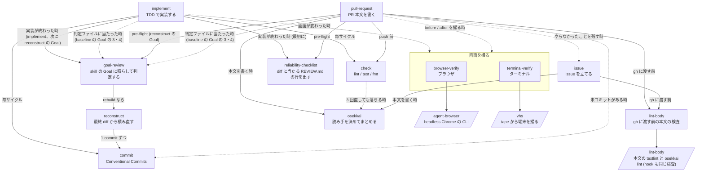
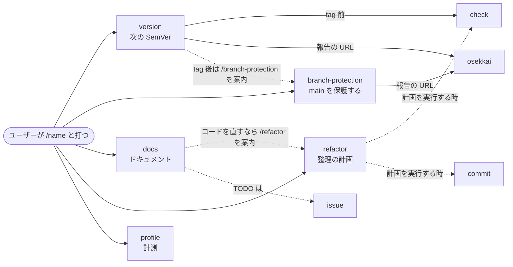
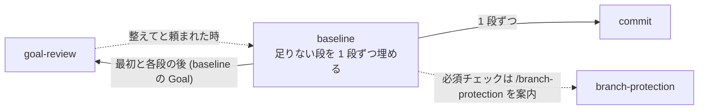
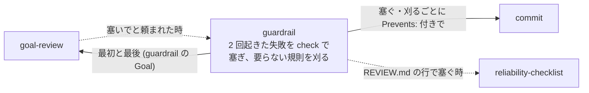
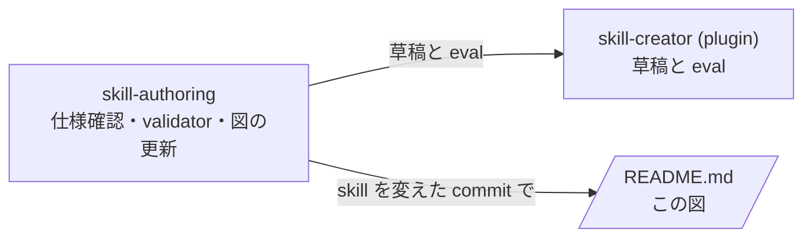

# agent skills

`skills/` の skill は、どう届くかで 2 種類に分かれる。「毎回回る」skill はモデルが一覧から読み込む。「打って使う」skill は `disable-model-invocation: true` で一覧から隠しており、ユーザーが `/name` (codex は `$name`) と打った時だけ動くので、毎セッションの一覧に description が載らない。隠した skill は他の skill からも読み込めない。そのため、そこへ向かう線は「/name を案内」と書き、ユーザーが打つまで止まる。図では実線が「その手順で必ず読み込む」、点線が「条件が合った時だけ読み込む」。

`AGENTS.md` は Claude だけの指示書ではない。`modules/ai/claude.nix` が `~/.claude/CLAUDE.md` に、`modules/ai/agents.nix` が `~/.codex/AGENTS.md` に、同じファイルを配る。毎セッション両 agent が読むので、AGENTS.md に置くのは、モデルが自分では再現しない家の規則のうち毎回効いてほしいもの (コードの切り方、動かし方、アンカーの書き方) と「いつ何を読むか」だけにする。1 つの作業の間だけ要る手順は skill 側に置く。

skill も同じ 2 経路で配る。各 feature が `my.skills` に載せた dir を、claude.nix が `~/.claude/skills/` に、agents.nix が codex 用の `~/.agents/skills/` に並べる (Claude Code は `~/.agents/` を読まない)。`~/.claude/skills/ha`、`~/.claude/skills/agent-browser`、`~/.claude/skills/osekkai` がここに無いのはそのためで、ha は flake input `kawarimidoll/ha` 同梱の skill を `modules/git/ha.nix` が、agent-browser は llm-agents.nix の `agent-browser` 同梱の skill を、osekkai は flake input `Xantibody/osekkai` 同梱の skill を `modules/ai/claude.nix` が `my.skills` に載せている。字幕を訳す `subtitles` は `configs/media/skills/subtitles` にあり、`modules/media.nix` が `subtitles` コマンドと一緒に載せるので、media を入れた Mac にだけ届く。`mcp-defaults` と `tsgo-lsp` は SKILL.md を持たない Claude plugin なので `~/.claude/skills/` にだけ置く。codex は frontmatter の `name` と `description` しか見ないので、`when_to_use` のトリガー語や `disable-model-invocation`、`hooks` は codex では効かず、隠す skill には `agents/openai.yaml` で同じことを書く。

`rtk` / `ck` / `codegraph` も skill ではなく `modules/ai/agents.nix` が入れるツールで、Claude には `settings.json` の hook と `mcp-defaults` が、codex には `/etc/codex/config.toml` と `~/.codex/hooks.json` が配線する。`rat` も skill ではなく、この repo の `tools/` にある Go のコマンドで、`modules/rat.nix` が全 host の PATH に載せる。`settings.json` の hook (`rat hook deny`・`rat hook gh-guard`・`rat hook anchors`)、pull-request と issue の frontmatter が登録する `rat hook lint-body`、commit gate の `rat verify-gate`、skill が呼ぶ `rat shot`・`rat checklist`・`rat hotspots`・`rat skill validate` はどれもそのサブコマンドで、道具を 1 つ足すときは `tools/` の下にディレクトリを 1 つ足す。

`textlint/` は skill ではなく、PR / issue 本文にかける textlint の設定と自前ルール。`modules/ai/_textlint.nix` (claude feature の一部) がこれを `lint-body` コマンドに焼き込む。`lint-body` は textlint のあとに同じファイルを `osekkai lint` にかけ、箇条や節の構造は osekkai のルールが見る。hook `rat hook lint-body` は pull-request と issue の frontmatter が skill を呼んだときに登録し、PATH の `lint-body` で `gh pr create` などの `--body-file` に指摘が残っていればコマンドを止める。

## 実装から PR まで

判断と実行は分けるが、判断する skill は `goal-review` 1 つだけにする。何かを変える skill (`implement`、`reconstruct`、`baseline`、`guardrail`) は本文の `## Goal` に「どうなっていれば済みか」と判定方法を書き、`goal-review` はその節だけを読んで判定し、Goal に書かれた条件で持ち主の skill に渡す。`implement` の Goal (check と `just smoke` が通り、画面が変わるなら撮って見た) は、終わった時に `implement` 自身が先に判定させ、done になってから reconstruct の Goal に進む。新しい実行 skill には、専用の review skill を作らず Goal を書く。

変更が自分を裁くチェックを同じ変更で緩めないよう、判定ファイル (justfile、`.github/workflows/`、lint・型の設定、suppression、`.claude/settings*.json`) は 2 層で守る。一覧は `baseline` の Goal の Judge files にあり、`settings.json` の `permissions.ask` が同じ一覧を `Edit(**/<pattern>)` で並べるので、編集のたびに確認が出る (`checks.judge-files` が 2 つの一覧のずれを落とす)。`implement` の終わりと `pull-request` の pre-flight は、range が判定ファイルに当たったら `baseline` の Goal を step 3・4 に限って判定させる。基準は skill と一緒に配られた references なので、変更からは届かない。

`reliability-checklist` は判定する skill ではない。repo の `REVIEW.md` を base 側から読み、diff に当たった行を `rat checklist` で出すだけで、各行の確認は呼んだ `implement` と `pull-request` が行う。

## 打って使う skill

## リポジトリの環境を作る時

`baseline` の言語別の既定 (TypeScript / Go / Rust / Nix) と雛形は skill を分けず、`baseline/references/` と `baseline/assets/` に置く。`docs` skill の ADR の作法も `baseline/references/docs.md` を指す。repo ごとの起動 skill (`<repo>-run`、feature map 付き) もここでは配らず、`baseline/assets/run-skill.md` を雛形に各 repo の `.claude/skills/` に置き、`.agents/skills/` からリンクする。`browser-verify` と `terminal-verify` はその skill を、なければ `just run` を起動手順として読み、見る行を feature map から選ぶ。

## 失敗を check に変える時

`guardrail` も判断を持たない。塞げていない失敗、事故で鳴らない check、刈り込む規則、done/ に移していない plan は `guardrail` の Goal に書き、`goal-review` が判定する。塞ぎ方は設計、型、lint・hook・deny、テスト、`REVIEW.md` の行、Goal の項目、文章の順に上から試し、新しい check は警告だけで入れてから落とすようにする。`.ai/` は CI から見えないので、plan の移し忘れは CI の check でなく Goal の項目にしている。

## skill を作る時

どこからも読み込まれず、ユーザーの依頼で直接呼ばれる skill:

- `subtitles` — 動画の字幕をローカルで訳す (media を入れたホストだけ)
