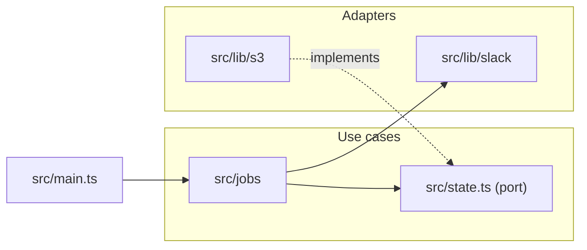

# Architecture

<!--
Skeleton for docs/architecture.md, the repository's map. Write it in the repo's language,
replace every <placeholder>, delete every comment. Keep it short: only what is unlikely to
change often. How a module works goes in docs/modules/<name>.md or in the code; why a rule
exists goes in docs/adr/.
-->

## Overview

<!-- 2-4 sentences: what the system does, what goes in and what comes out, where it runs.
The README sells the project; this section orients someone about to change it. -->

<What the system does, its inputs and outputs, and where it runs.>

## Codemap

<!-- Components and the boundaries between them. One node per top-level module or
deployable; an arrow means "depends on / calls". Draw the boundary as a subgraph.
Omit the diagram when there are fewer than three components. The names below are
examples; replace them. Keep "<" and ">" out of labels, which mermaid reads as HTML. -->

<!-- One line per module. Name code paths in backticks instead of linking them (links to
code go stale; symbol search does not). Link a docs/modules/ page when one exists. -->

- `<path/>` — <what it owns>. <[Details](modules/<name>.md)>
- `<path/>` — <what it owns>.

## Rules

<!-- The invariants a change must keep, most often an absence ("X never imports Y").
Each row names the check that enforces it and what its error tells you to do instead.
A rule nothing enforces says "prose only"; that is a candidate for a lint or a test. -->

| Rule                               | Enforced by                   | Instead, do                   | Decided in                     |
| ---------------------------------- | ----------------------------- | ----------------------------- | ------------------------------ |
| <`core/` never imports `lib/`>     | <`just check`: tool and rule> | <depend on the port in core/> | [<NNNN>](adr/<NNNN>-<slug>.md) |
| <Lint suppressions carry a reason> | <`just check`: tool and rule> | <`HACK(<issue URL>): <why>`>  | [<NNNN>](adr/<NNNN>-<slug>.md) |

## Cross-cutting concerns

<!-- Only the ones this repo actually has: error handling, configuration, logging,
where tests live, generated code. One or two lines each. Delete the section if empty. -->

- <Concern>: <where it is handled and the convention>.

## Decisions

Why the system has this shape is recorded in [`adr/`](adr/), one decision per file,
numbered in the order they were made. This page states the current shape; when an ADR
changes a rule above, update the row in the same commit.

## Glossary

<!-- Domain terms a newcomer would misread. Delete the section if there are none. -->

- **<Term>**: <meaning in this codebase>.
